O Programa de Pós-Graduação **Mestrado Profissional em Tecnologia das Radiações em Ciências da Saúde (MP-TRCS)** do IPEN-CNEN realizou, no dia **26 de novembro de 2026**, a oitava edição do seu Workshop anual, no Prédio do Ensino.

Atividade acadêmica obrigatória na formação dos mestrandos, o encontro reuniu alunos, orientadores, pesquisadores e autoridades institucionais em um formato de congresso científico voltado ao acompanhamento das dissertações e dos produtos técnicos e tecnológicos em desenvolvimento.

::: {.text-center .my-4}
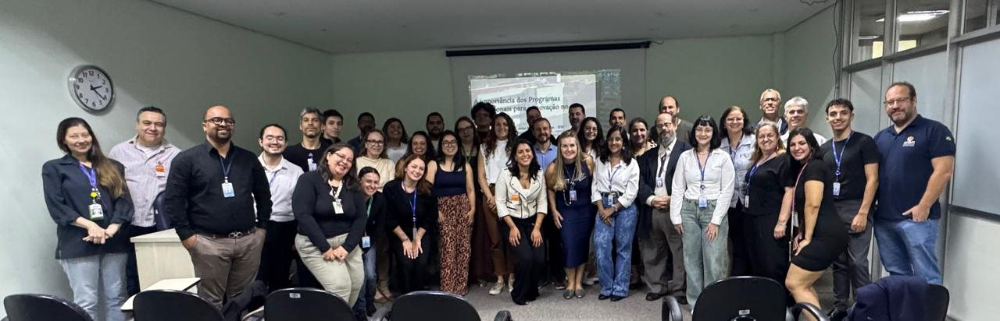{.img-fluid .w-100 .rounded .shadow group="workshop-2026"}
:::

---

## Reunião Docente, Abertura Oficial e Diálogo com a CAPES

As atividades tiveram início pela manhã, às 10h00, com uma reunião de trabalho entre o corpo docente do MP-TRCS e a **Profa. Dra. Daiane Cristini Barbosa de Souza**, Coordenadora Adjunta da Área de Medicina II da CAPES/MEC. Na conversa, a Dra. Daiane abordou a **Avaliação Quadrienal da CAPES**, detalhando a importância de todo o corpo docente conhecer o funcionamento, os critérios e os parâmetros avaliativos, de modo que a construção dos elementos a serem avaliados ocorra de maneira contínua e planejada ao longo dos quatro anos do ciclo.

No início da tarde, a sessão solene de abertura dos trabalhos contou com a participação do **Dr. Marcelo Linardi**, representando a Direção do IPEN — um dos idealizadores do Mestrado Profissional, que liderou o processo de formulação e submissão do programa junto à CAPES —, da **Dra. Martha Ribeiro**, Gerente do Ensino do IPEN, e da **Dra. Denise Zezell**, Coordenadora do MP-TRCS. Na sequência, a Profa. Denise M. Zezell, coordenadora do Mestrado Profissional apresentou a profa Daiane, que 
ministrou aos discentes e orientadores a palestra intitulada *"A importância dos programas profissionais na inovação no Brasil"*, seguida de debate com a plateia.

<!-- ::: {layout-ncol=3} -->
<!-- 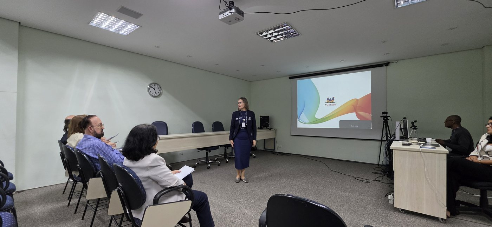{group="workshop-2026"} -->

<!-- 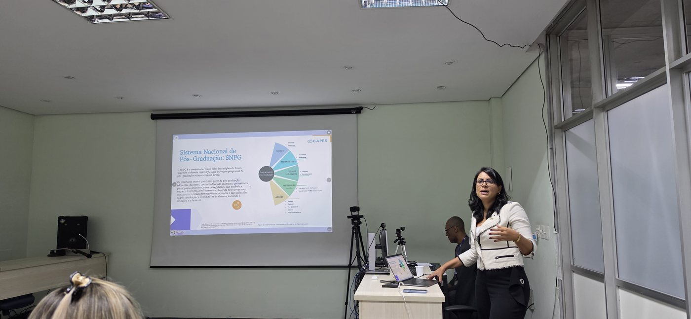{group="workshop-2026"} -->

<!-- 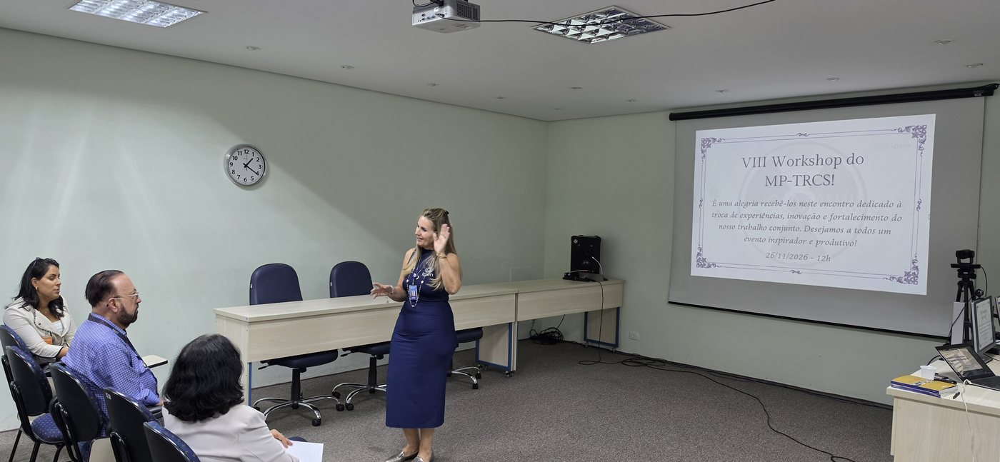{group="workshop-2026"} -->
<!-- ::: -->

::: {layout-ncol=3}
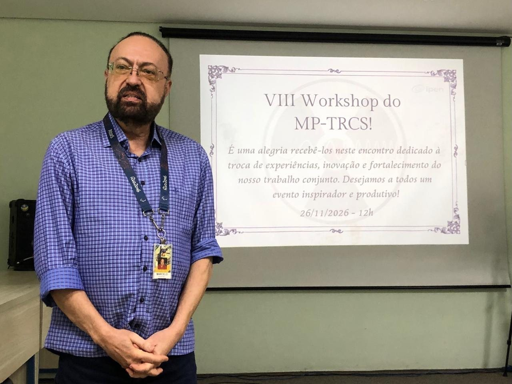{.img-fluid .w-100 .rounded group="workshop-2026" style="height: 300px; object-fit: cover; object-position: center 15%;"}

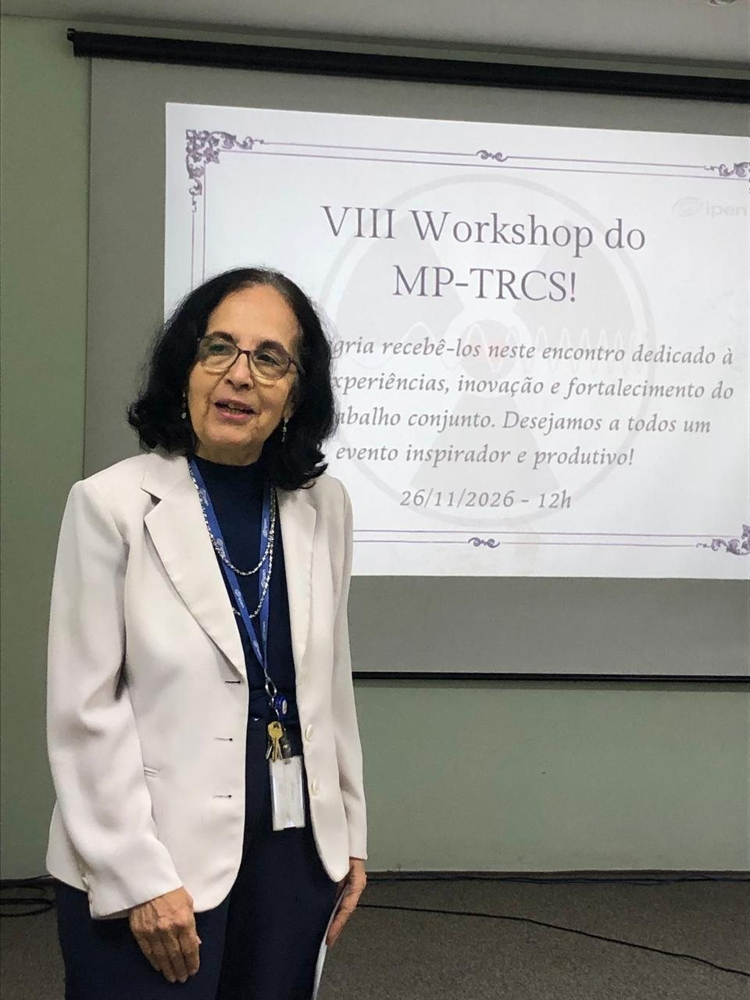{.img-fluid .w-100 .rounded group="workshop-2026" style="height: 300px; object-fit: cover; object-position: center 15%;"}

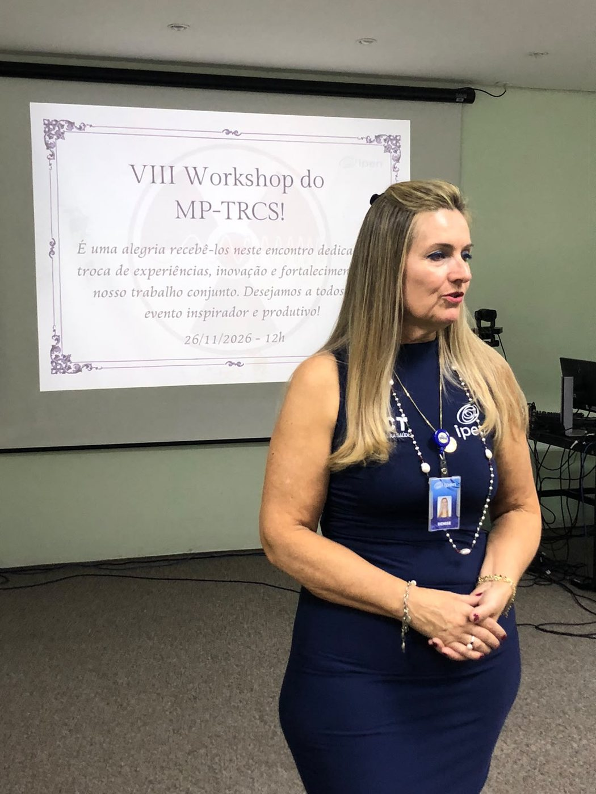{.img-fluid .w-100 .rounded group="workshop-2026" style="height: 300px; object-fit: cover; object-position: center 15%;"}
:::

::: {layout-ncol=2}
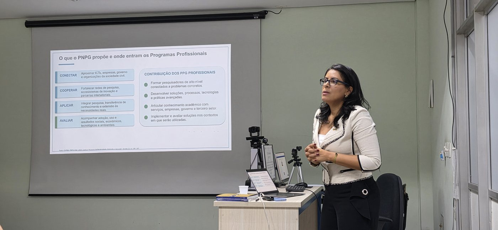{.img-fluid .w-100 .rounded group="workshop-2026" style="height: 280px; object-fit: cover; object-position: center 25%;"}

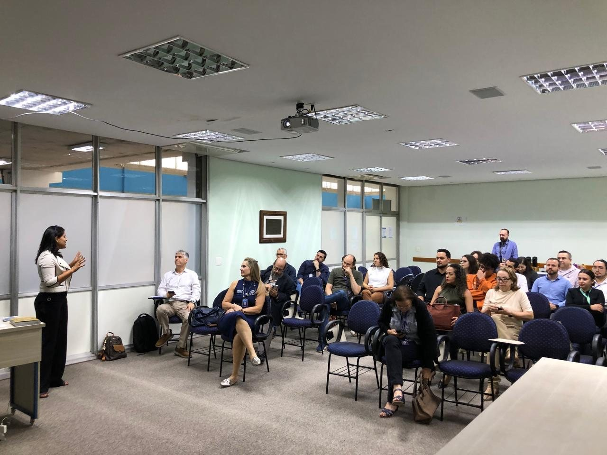{.img-fluid .w-100 .rounded group="workshop-2026" style="height: 280px; object-fit: cover; object-position: center 25%;"}
:::

---

## Depoimento Discente, Pôsteres e Aplicação Prática

Às 14h30, o mestrando **Paulo Henrique Ruis Garcia** (Turma 7) compartilhou sua experiência no programa e apresentou duas conquistas recentes obtidas durante o mestrado: a distinção **Magna Cum Laude** na Jornada Paulista de Radiologia (JPR), concedida pelo rigor metodológico e inovação do estudo *"Avaliação da Maturidade Metodológica da Radiômica em Periódicos Brasileiros: Uma Revisão Integrativa baseada no Radiomics Quality Score 2.0"* (em coautoria com Ana Carolina Costa da Silva e Orlando Rodrigues Junior), e o **1º lugar na Latin American Nuclear Olympiad 2026** — edição dedicada a radioteranósticos promovida em parceria com a *Hackapower* — com a proposta *"The LATAM Radiopharmaceutical System (LRS): A Digital Infrastructure to Expanding Radiotheranostics in Latin America"*, que lhe garantiu o convite para apresentá-la no *Global Ambassadors Meeting* da *Oncidium Foundation*, durante o congresso **EANM 2026**, em Viena.

Na sequência, a programação seguiu para o saguão do Prédio do Ensino com a sessão de exposição e arguição de pôsteres pelos mestrandos, avaliada pelos orientadores do programa. Entre os trabalhos apresentados, destacou-se a dimensão aplicada das pesquisas em saúde e proteção radiológica, incluindo demonstração prática de atendimento pré-hospitalar para vítimas de acidente radiológico e a exposição das viaturas de Proteção Radiológica e Emergência do IPEN/CNEN.

::: {layout-ncol=2}
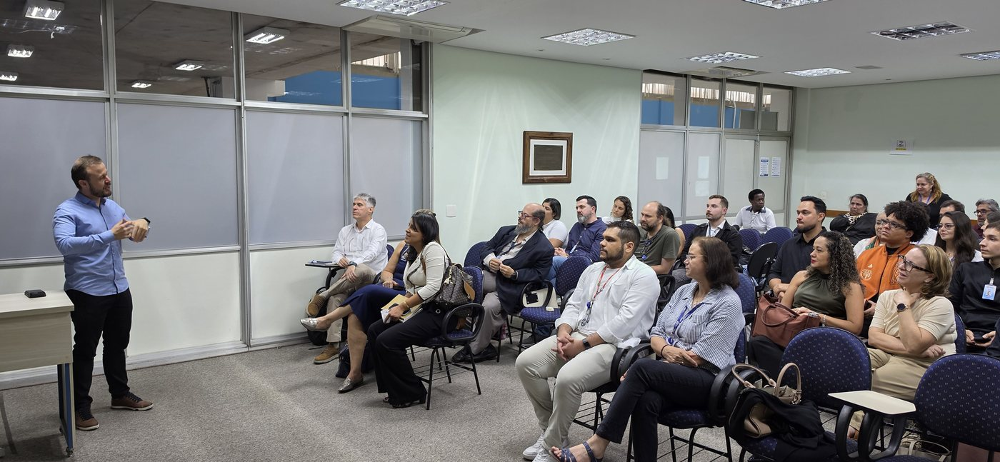{group="workshop-2026"}

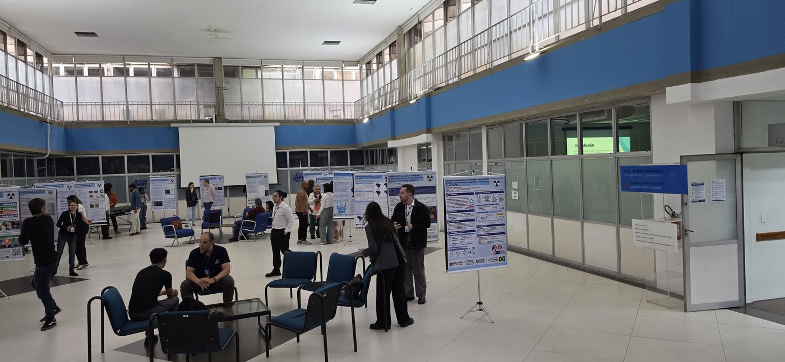{group="workshop-2026"}

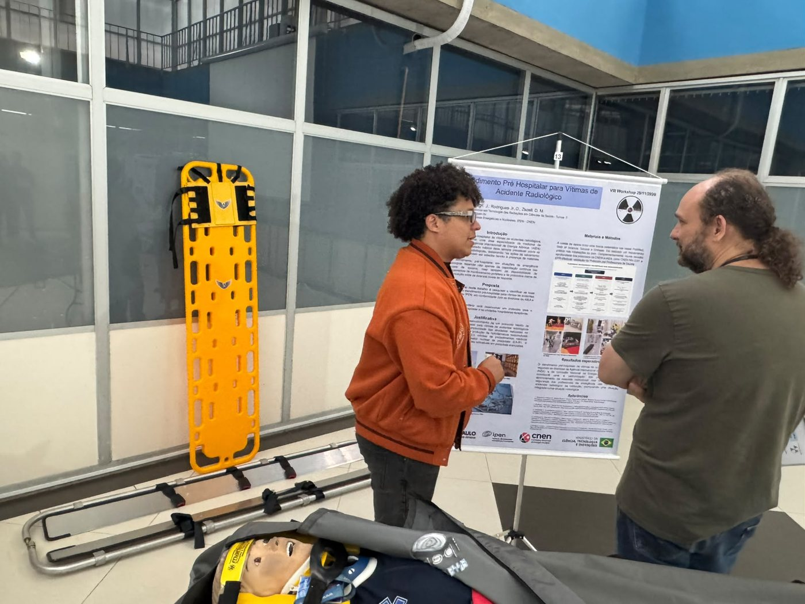{group="workshop-2026"}

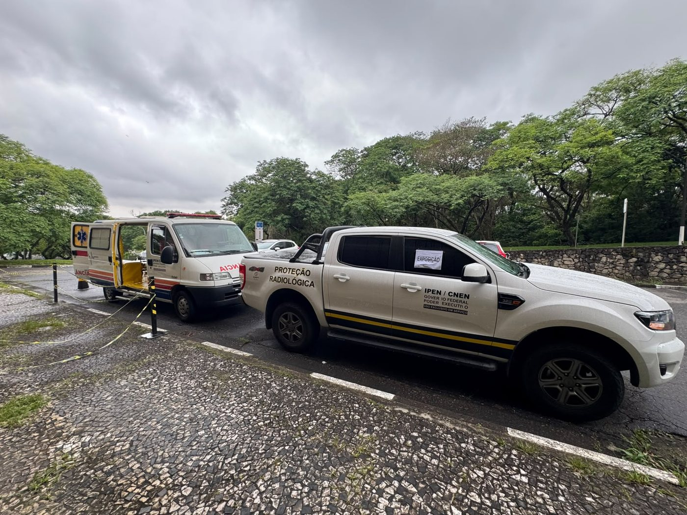{group="workshop-2026"}
:::

---

## Palestra de Encerramento e Premiação

No encerramento do evento, às 16h30, o **Prof. Dr. Fábio Luiz Navarro Marques** (Radioquímico da FMUSP e Presidente da Sociedade Brasileira de Biociências Nucleares – SBBN) apresentou a palestra *"Uma breve história da ciência nuclear e da radiofarmácia"*, abordando a trajetória histórica e científica da radioquímica e das ciências nucleares aplicadas à saúde.

::: {.grid .align-items-center .g-3 .mb-4}
::: {.g-col-12 .g-col-md-4}
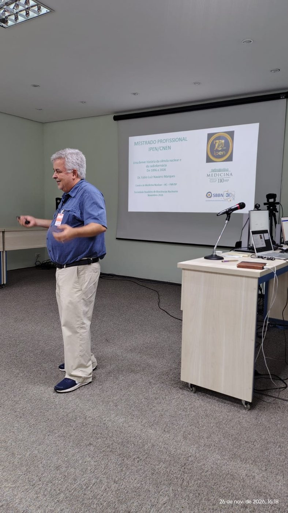{group="workshop-2026"}
:::

::: {.g-col-12 .g-col-md-8}
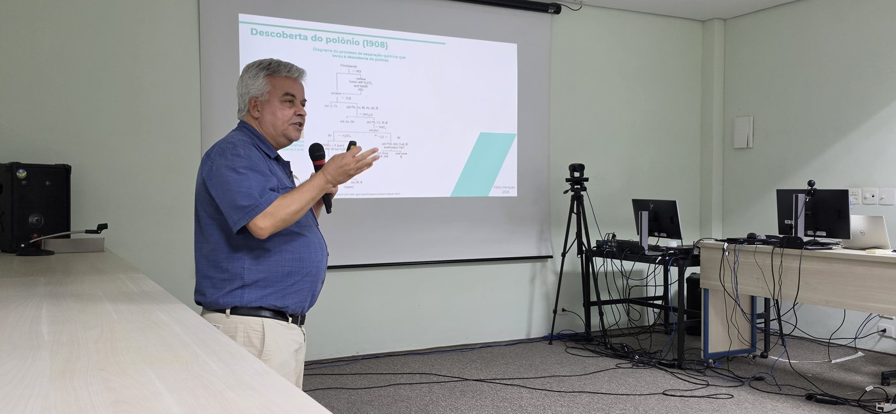{group="workshop-2026" .mb-3}

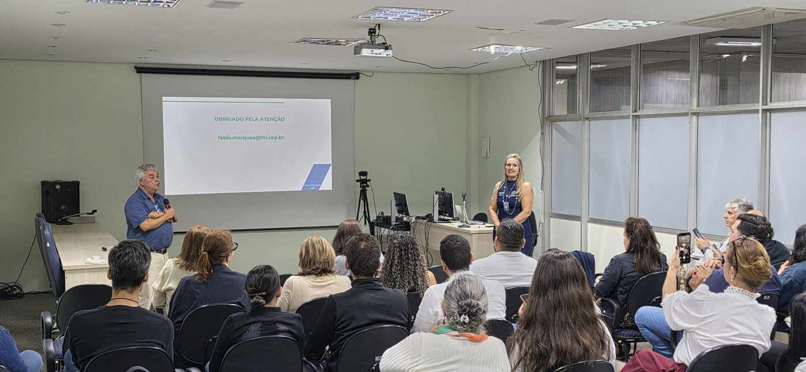{group="workshop-2026"}
:::
:::

Às 18h00, a coordenação realizou o anúncio e a premiação dos melhores trabalhos avaliados na sessão de pôsteres:

* **1º lugar:** **Paula Eduarda Vicente da Silva**;
* **2º lugar (empate):** **Ricardo Rodrigo Jefferson Conceição** e **Paulo Henrique Ruis Garcia** *(não houve 3º colocado)*;
* **Menções honrosas:** aluno **Jardson**, egressa **Juliana**, **Bhayan Bernardo de Araújo Silva** e **Marcelo Toshio Tadeu Caliman Sato**, pelos pôsteres apresentados.

::: {layout-ncol=2}
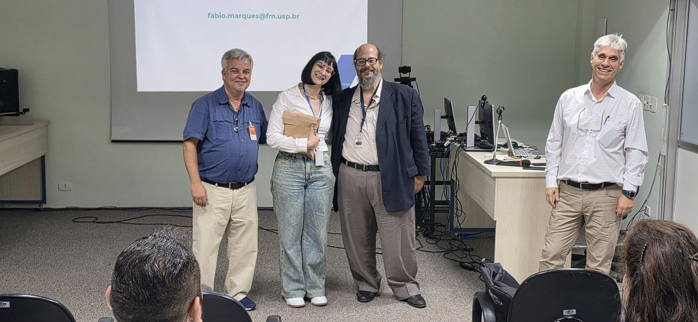{group="workshop-2026"}

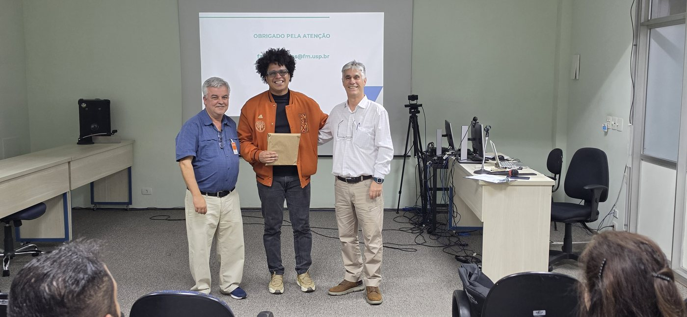{group="workshop-2026"}

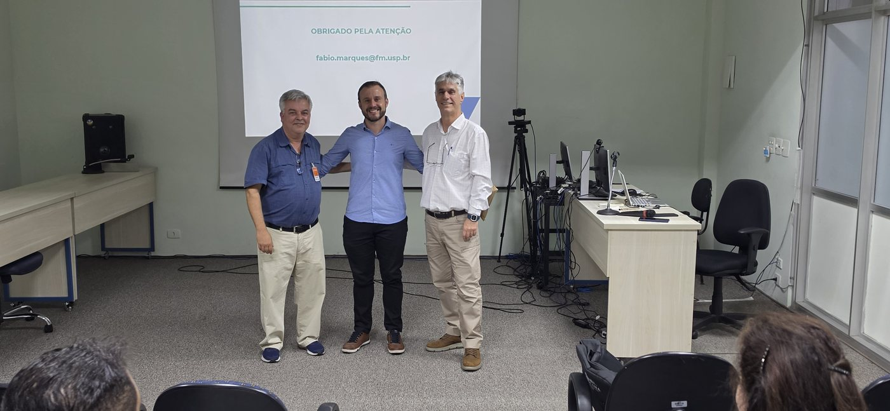{group="workshop-2026"}

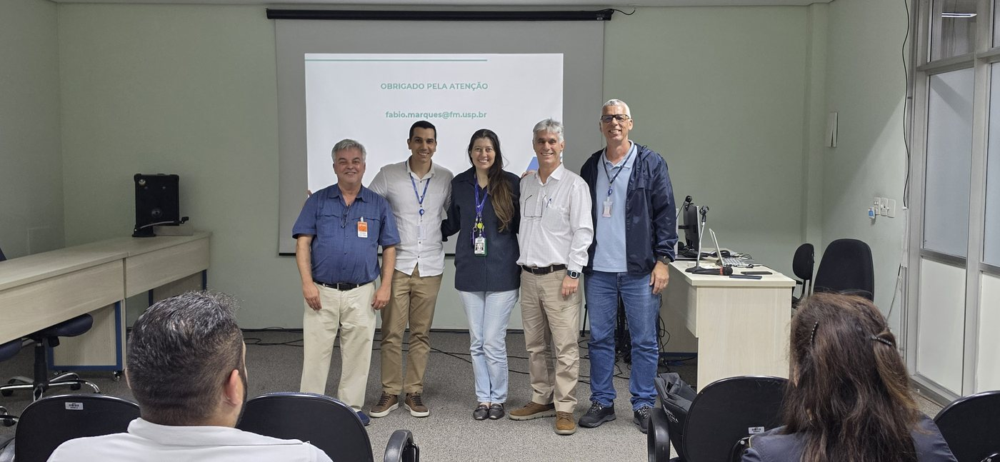{group="workshop-2026"}
:::

### Agradecimento

A Coordenação do MP-TRCS registra um agradecimento especial às secretárias do programa, **Andrea** e **Letícia**, pelo empenho e dedicação em todas as etapas da organização e realização do VIII Workshop.

---

::: {.callout-tip title="Registros em Vídeo"}
Trechos em vídeo do evento também podem ser acompanhados nas redes sociais oficiais do programa em [@mptrcs.ipen](https://instagram.com/mptrcs.ipen/).
:::

*Fotos tiradas pela equipe do MP.*

::: {.d-flex .justify-content-center .gap-3 .mt-5 .flex-wrap}
[<i class="bi bi-calendar-check"></i> Ver Programação Original](viii-workshop-2026.qmd){.btn .btn-outline-primary}
[<i class="bi bi-newspaper"></i> Todas as Notícias](index.qmd){.btn .btn-outline-secondary}
[<i class="bi bi-arrow-left"></i> Home](../index.qmd){.btn .btn-primary}
:::
