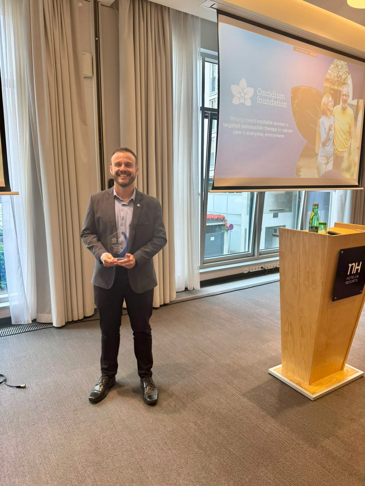
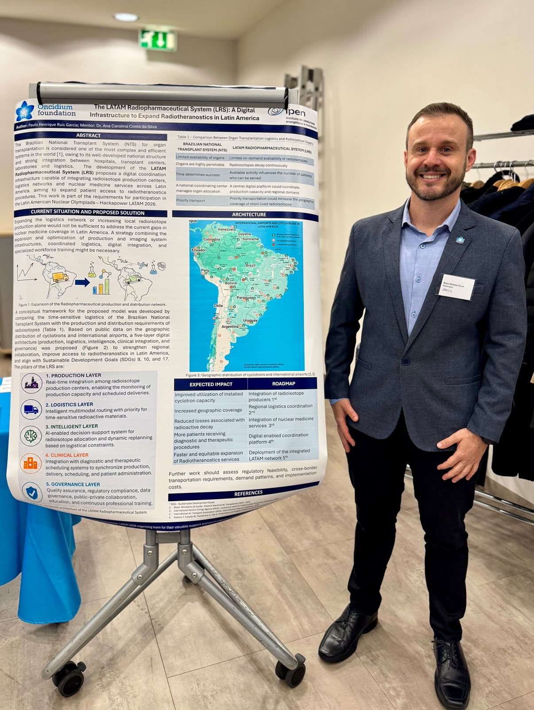
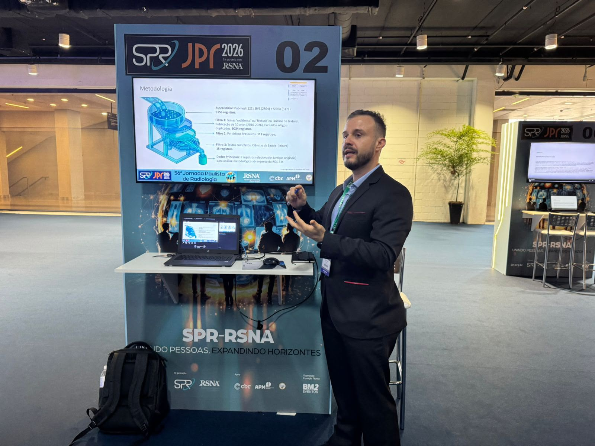

::: {.text-center .mb-4}
{.img-fluid .rounded .shadow style="max-height: 480px; border: 1px solid #dee2e6;" alt="Rebecca Lo bue (CEO da Oncidium Foundation), Dra. Ana Carolina Costa da Silva e Paulo Henrique Ruis Garcia em Viena"}

  <em>Celebração em Viena: Rebecca Lo bue (CEO da Oncidium Foundation), Dra. Ana Carolina Costa da Silva (Siemens Healthineers / IPEN-USP) e o mestrando Paulo Henrique Ruis Garcia (MP-TRCS / Siemens Healthineers).</em>

:::

::: {.lead}
O **Mestrado Profissional em Tecnologia das Radiações em Ciências da Saúde (MP-TRCS)** do IPEN-CNEN celebra uma dupla conquista acadêmica e científica de projeção internacional. O discente **Paulo Henrique Ruis Garcia** (Turma 7), orientado pelo **Prof. Dr. Orlando Rodrigues Junior**, conquistou o primeiro lugar nas **Olimpíadas Nucleares da América Latina 2026** e a condecoração máxima **Magna Cum Laude** na **56ª Jornada Paulista de Radiologia (JPR 2026)**.
:::

As premiações evidenciam a excelência da formação propiciada pelo MP-TRCS, que une o rigor acadêmico da pós-graduação stricto sensu do IPEN à resolução de desafios concretos de saúde pública, conectando inovação tecnológica, medicina de precisão e a indústria de ponta.

---

## 1. Vitória nas Olimpíadas Nucleares da América Latina 2026 (Viena, Áustria)

O projeto intitulado ***"Latin American Radiopharmaceutical System (LRS): A Digital Platform to Expand Radiotheranostics in Latin America"*** sagrou-se grande vencedor das **Olimpíadas Nucleares da América Latina 2026** (*Latin American Nuclear Olympiad*), competição de inovação voltada a impulsionar soluções de alto impacto para o setor nuclear e a medicina personalizada na região.

::: {.callout-note title="O que é o Sistema LRS?"}
A proposta estabelece uma plataforma digital estruturada em camadas integradas para superar os gargalos logísticos, regulatórios e de distribuição de radiofármacos voltados à **radioteranóstica** — abordagem revolucionária na oncologia que combina o diagnóstico precoce por imagem molecular e a terapia de precisão com alvos tumorais específicos.
:::

A final do evento ocorreu em **Viena (Áustria)**, sede da Agência Internacional de Energia Atômica (AIEA/IAEA). Na ocasião, o discente e pesquisador do IPEN esteve acompanhado da **Dra. Ana Carolina Costa da Silva** (Doutora em Tecnologia Nuclear pelo IPEN-USP e *Collaboration Manager CT for Latin America* na Siemens Healthineers) e de **Rebecca Lo bue** (CEO da *Oncidium Foundation*, entidade global de fomento e democratização do acesso a radioteranósticos).

::: {.grid .my-4 .align-items-center}
::: {.g-col-12 .g-col-md-6}
{.img-fluid .rounded .shadow style="max-height: 420px; width: 100%; object-fit: cover;" alt="Apresentação do poster técnico do sistema LRS em Viena"}
:::
::: {.g-col-12 .g-col-md-6}
### Impacto Translacional
O desenvolvimento do sistema digital LRS endereça um dos desafios mais prementes da América Latina: a curta meia-vida física dos radioisótopos e a concentração dos centros de produção (cíclotrons e reatores). 

A ferramenta modela fluxos em tempo real integrando centros produtores, malhas de transporte aéreo e serviços hospitalares de radioterapia e medicina nuclear, viabilizando o tratamento oncológico de precisão em escala regional.
:::
:::

---

## 2. Distinção Magna Cum Laude na 56ª Jornada Paulista de Radiologia (JPR 2026)

Consolidando a maturidade científica de sua trajetória no mestrado profissional, Paulo Henrique recebeu também a condecoração **Magna Cum Laude** na **56ª Jornada Paulista de Radiologia (JPR 2026)** — maior evento da especialidade na América Latina e quarto maior do mundo, promovido pela Sociedade Paulista de Radiologia (SPR) em parceria com a *Radiological Society of North America* (RSNA).

A honraria é concedida pela Comissão Científica exclusivamente aos estudos que atingem os mais elevados patamares de **rigor metodológico, originalidade, relevância clínica e excelência na apresentação**.

::: {.grid .my-4 .align-items-center}
::: {.g-col-12 .g-col-md-5}
{.img-fluid .rounded .shadow style="max-height: 440px; width: 100%; object-fit: cover;" alt="Paulo Henrique Ruis Garcia na Jornada Paulista de Radiologia 2026"}
:::
::: {.g-col-12 .g-col-md-7}
### O Trabalho Condecorado
* **Título:** *"Avaliação da Maturidade Metodológica da Radiômica em Periódicos Brasileiros: Uma Revisão Integrativa baseada no Radiomics Quality Score 2.0"*
* **Autoria:** Paulo Henrique Ruis Garcia, Dra. Ana Carolina Costa da Silva e Prof. Dr. Orlando Rodrigues Junior (Orientador).

O estudo realizou uma auditoria criteriosa da literatura nacional recente sobre **radiômica** e inteligência artificial aplicadas ao diagnóstico por imagem, avaliando a conformidade metodológica dos artigos frente ao padrão internacional *Radiomics Quality Score 2.0* (RQS 2.0).
:::
:::

O trabalho apontou caminhos essenciais para elevar a reprodutibilidade dos modelos preditivos e algoritmos computacionais no Brasil, garantindo que as ferramentas de IA em saúde transitem com segurança do laboratório para o leito do paciente.

---

## Sinergia entre Academia, Indústria e Saúde Pública

Paulo Henrique atua profissionalmente como *Clinical Application Specialist* na Siemens Healthineers e ingressou no MP-TRCS na Turma 7, com o objetivo de aprofundar sua formação acadêmica sob a tutela do corpo docente do IPEN. 

Essa trajetória sintetiza o modelo de sucesso do **Mestrado Profissional**:

1. **Geração de Produtos Técnicos e Tecnológicos (PTT):** Desenvolvimento de soluções digitais e frameworks metodológicos aplicados;
2. **Transferência de Conhecimento:** Diálogo contínuo entre pesquisadores, centros de excelência médica e corporações de tecnologia em saúde;
3. **Formação de Lideranças:** Discentes capacitados para atuar na fronteira do conhecimento regulatório, metrológico e clínico.

::: {.callout-tip title="Depoimento no VIII Workshop do MP-TRCS"}
Os discentes, orientadores e a comunidade do IPEN poderão conferir os relatos e a trajetória de Paulo Henrique de perto durante o **[VIII Workshop do Mestrado Profissional](viii-workshop-2026.qmd)**, no dia **26 de novembro de 2026**, às 14h30, no Prédio do Ensino do IPEN.
:::

A Coordenação do MP-TRCS e toda a comunidade do IPEN-CNEN parabenizam o discente **Paulo Henrique Ruis Garcia**, seu orientador **Prof. Dr. Orlando Rodrigues Junior** e a colaboradora **Dra. Ana Carolina Costa da Silva** por representarem com tanto brilhantismo a ciência brasileira nos cenários nacional e internacional!

---

::: {.d-flex .justify-content-center .gap-3 .mt-5 .flex-wrap}
[<i class="bi bi-newspaper"></i> Todas as Notícias](index.qmd){.btn .btn-outline-secondary}
[<i class="bi bi-arrow-left"></i> Voltar para Home](../index.qmd){.btn .btn-outline-primary}
[Conheça as Linhas de Pesquisa <i class="bi bi-arrow-right"></i>](../programa/linhas-pesquisa.qmd){.btn .btn-primary}
:::
