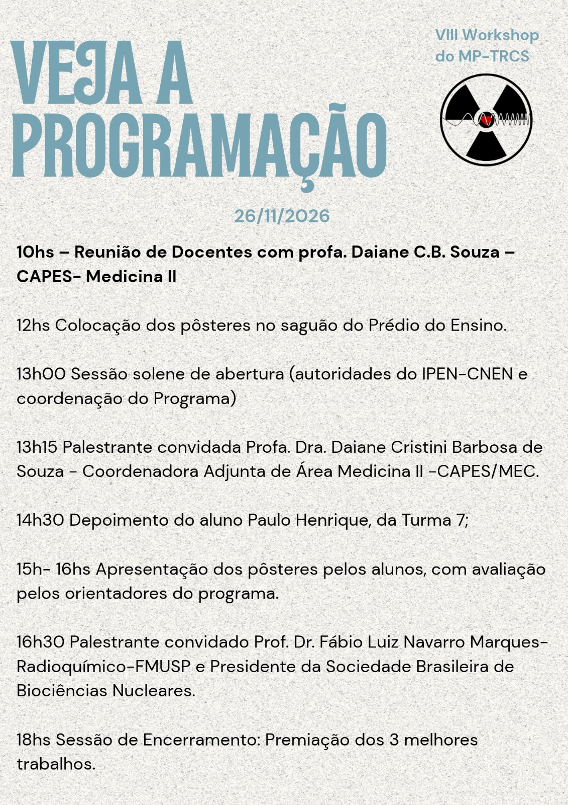

::: {.text-center .mb-4}
{.img-fluid .rounded .shadow style="max-height: 550px; border: 1px solid #dee2e6;" alt="Cartaz oficial com a programação do VIII Workshop do MP-TRCS"}
:::

A Comissão de Pós-Graduação do **Mestrado Profissional em Tecnologia das Radiações em Ciências da Saúde (MP-TRCS)** do IPEN-CNEN informa a programação do **VIII Workshop do Mestrado Profissional**, que ocorrerá no dia **26 de novembro de 2026**.

O Workshop é uma atividade acadêmica anual de caráter **obrigatório** para os alunos do programa. O evento é estruturado no formato de congresso científico, constituindo uma oportunidade para que os discentes apresentem o andamento de suas pesquisas e os produtos técnicos e tecnológicos desenvolvidos no curso.

---

## Participação da CAPES e Palestrantes Convidados

Nesta edição, o evento contará com a participação da **Profa. Dra. Daiane Cristini Barbosa de Souza**, Coordenadora Adjunta da Área de Medicina II da CAPES/MEC, que estará presente nas seguintes atividades:

* **10h00:** Reunião com os docentes do MP-TRCS sobre critérios e acompanhamento da área de Medicina II;
* **13h15:** Palestra dirigida aos alunos, orientadores e pesquisadores do programa.

A programação da tarde também contempla:

* **14h30:** Depoimento do aluno Paulo Henrique, da Turma 7;
* **16h30:** Palestra do **Prof. Dr. Fábio Luiz Navarro Marques** (Radioquímico da FMUSP e Presidente da Sociedade Brasileira de Biociências Nucleares – SBBN);
* **18h00:** Premiação dos três melhores trabalhos avaliados durante a sessão de pôsteres.

---

## Programação Completa (26/11/2026)

| Horário | Atividade | Local / Participantes |
| :---: | :--- | :--- |
| **10h00** | **Reunião de Docentes com a CAPES** | Profa. Dra. Daiane C. B. Souza (CAPES Medicina II) e docentes do MP-TRCS |
| **12h00** | **Montagem dos Pôsteres** | Saguão do Prédio do Ensino |
| **13h00** | **Sessão Solene de Abertura** | Direção do IPEN–CNEN e Coordenação do Programa |
| **13h15** | **Palestra Convidada** | Profa. Dra. Daiane Cristini Barbosa de Souza (Coordenadora Adjunta Medicina II – CAPES/MEC) |
| **14h30** | **Depoimento de Aluno** | Paulo Henrique (Turma 7) |
| **15h00 – 16h00** | **Apresentação de Pôsteres e Avaliação** | Apresentação dos alunos avaliada pelos orientadores do programa |
| **16h30** | **Palestra Convidada** | Prof. Dr. Fábio Luiz Navarro Marques (Radioquímico–FMUSP e Presidente da SBBN) |
| **18h00** | **Encerramento e Premiação** | Divulgação e entrega de certificados aos 3 melhores trabalhos |

---

## Orientações para os Alunos

::: {.callout-important title="Requisito Curricular"}
A participação no Workshop e a apresentação de pôster constituem atividade acadêmica obrigatória para a conclusão do curso no MP-TRCS.
:::

::: {.callout-note title="Instruções para Apresentação dos Pôsteres"}
Os discentes devem observar o seguinte cronograma:

1. **Instalação dos painéis:** os pôsteres devem ser fixados impreterivelmente às **12h00**, no saguão do Prédio do Ensino;
2. **Arguição:** os autores devem permanecer junto aos seus respectivos painéis durante todo o período das **15h00 às 16h00** para atendimento à comissão avaliadora e ao público;
3. **Avaliação:** a comissão de orientadores atribuirá notas aos trabalhos considerando rigor metodológico, clareza na exposição e relevância dos resultados para a área da saúde;
4. **Premiação:** no encerramento, às **18h00**, serão anunciados os 3 trabalhos mais bem pontuados.
:::

---

::: {.d-flex .justify-content-center .gap-3 .mt-5 .flex-wrap}
[<i class="bi bi-file-earmark-arrow-down"></i> Baixar Cartaz da Programação](../arquivos/Programacao_VIII_Workshop_2026.jpeg){.btn .btn-outline-primary target="_blank"}
[<i class="bi bi-newspaper"></i> Notícias](index.qmd){.btn .btn-outline-secondary}
[<i class="bi bi-calendar-event"></i> Calendário Acadêmico](../academico/calendario.qmd){.btn .btn-outline-info}
[<i class="bi bi-arrow-left"></i> Home](../index.qmd){.btn .btn-primary}
:::
